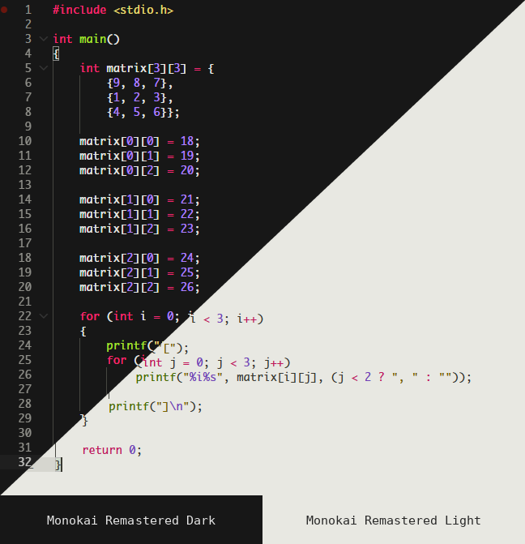

# Monokai Remastered Dark & Light

A premium VS Code theme crafted for developers who want clarity, contrast, and elegance in every line of code.

Monokai Remastered Dark & Light brings together a dark, cinematic palette and a refined light variant, designed for long coding sessions without visual fatigue.

## Theme variants

- Monokai Remastered Dark — deep black surfaces, vibrant accents, built for focus and contrast
- Monokai Remastered Light — soft neutral backgrounds, crisp text, made for clean daytime work

## Why developers choose it

- High contrast for readability and syntax clarity
- Balanced accents that stand out without overwhelming the editor
- Designed for modern languages and long work sessions
- Clean visual identity for both dark and light workflows

## Preview

### Monokai Remastered Dark

- Background: `#171717`
- Foreground: `#E6E6E3`
- Accent: `#F92672`
- String: `#5DC863`
- Keyword/constant: `#E6DB74`

### Monokai Remastered Light

- Background: `#E8E8E2`
- Foreground: `#383830`
- Accent: `#C2185B`
- String: `#476C00`
- Keyword/constant: `#716500`

## Features

- Optimized for code readability in VS Code
- Crisp editor surfaces, sidebars, tabs, and terminal styling
- Consistent color rhythm across dark and light themes
- Suitable for JavaScript, TypeScript, Python, Go, Rust, C#, Java, and more

## Recommended setup

For the best experience, pair it with a modern monospace font such as:

- [Monego](https://github.com/cseelus/monego)
- [Source Code Pro](https://fonts.google.com/specimen/Source+Code+Pro)
- [JetBrains Mono](https://www.jetbrains.com/pt-br/language-mono/)
- [Fira Code](https://github.com/tonsky/FiraCode)

## Available themes

- `Monokai Remastered Dark`
- `Monokai Remastered Light`

## License

This project is distributed under the MIT license.

## Author

Built by Willian Juliate.
